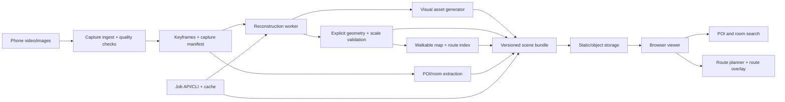

# Namma Space — Proposed Architecture

## 1. Architectural thesis

Namma Space should treat a venue as a versioned **scene bundle** with multiple synchronized representations:

1. A photorealistic visual representation for the browser.
2. An explicit geometry representation for collision and navigation.
3. A semantic representation for rooms and POIs.
4. Evidence and quality metadata describing how trustworthy the scene is.

The visual representation and the navigation representation should be separate outputs generated from the same reconstruction coordinate frame. This avoids forcing a Gaussian-splat renderer to provide collision geometry or forcing a collision mesh to carry photorealistic detail.

## 2. System context



## 3. Module boundaries

### A. Capture and ingest

**Responsibility:** turn raw phone media into a normalized, inspectable input set.

Inputs:

- `capture.mp4` or an image directory.
- Optional phone metadata.
- Optional measured scale anchors.

Outputs:

- Normalized frames.
- Frame timestamps and source hashes.
- Candidate keyframes.
- Capture-quality report.

The module must not know whether reconstruction is COLMAP, VGGT, or AMB3R. It emits a stable frame manifest.

### B. Reconstruction adapter

**Responsibility:** estimate camera poses, intrinsics, depth/points, confidence, and a reconstruction-space coordinate frame.

```text
ReconstructionAdapter.run(FrameSet, ReconstructionConfig)
  -> ReconstructionResult
```

The adapter boundary allows:

- `colmap-baseline`.
- `vggt-initializer`.
- `amb3r-experiment`.
- Future engines without viewer changes.

### C. Visual asset generator

**Responsibility:** create one or more browser-ready visual assets.

```text
VisualAssetGenerator.build(ReconstructionResult, VisualConfig)
  -> VisualAsset
```

Round 1 should output a GLB/glTF mesh or a pre-baked scene asset. A Gaussian-splat output may be added later as a second visual layer.

### D. Explicit geometry and scale validation

**Responsibility:** create collision-ready geometry, detect a floor plane, simplify obstacles, and validate metric scale.

```text
GeometryProcessor.build(ReconstructionResult, GeometryConfig)
  -> GeometryResult
```

This output is authoritative for collisions and navigation, not the photorealistic asset.

### E. Semantic extraction

**Responsibility:** associate rooms and POIs with stable world-space anchors.

Round 1/early Round 2 can use operator-authored JSON. Automated detection, OCR, segmentation, and image-text matching should populate the same schema later.

```text
SemanticExtractor.extract(FrameSet, ReconstructionResult, SemanticConfig)
  -> SemanticResult
```

### F. Navigation

**Responsibility:** derive a walkable representation and validate paths.

```text
NavigationBuilder.build(GeometryResult, NavigationConfig)
  -> WalkableMap
RoutePlanner.find(WalkableMap, start, goal, RouteConfig)
  -> RouteResult
```

The first implementation should use a 2D occupancy grid and A* with a configurable agent radius. The route validator must check bounds, blocked cells, and clearance rather than trusting the planner alone.

### G. Browser viewer

**Responsibility:** load a scene bundle and provide a usable walkthrough. React owns the application shell; PlayCanvas Engine 2.x owns the canvas and 3D entity lifecycle.

The viewer consumes only public scene contracts:

- `scene.json`.
- Visual asset URL(s).
- Collision geometry or walkable map URL.
- `pois.json`.
- Optional `walkable.json`.

It should not import Python packages, reconstruction internals, or model-specific formats directly.

### H. Job and deployment layer

**Responsibility:** run processing stages independently, cache successful outputs, expose state, and publish only validated bundles.

Round 1 can be a CLI and filesystem. A FastAPI service should be added only when upload, status, or remote processing is actually needed.

Every job must have:

- An immutable input hash.
- A pipeline version.
- A configuration hash.
- Stage-level status.
- Structured logs.
- Output artifact references.
- A retry-safe state transition.

## 4. Canonical data contracts

### `SceneManifest`

```json
{
  "sceneId": "venue-2026-10-24-001",
  "sceneVersion": 1,
  "coordinateSystem": "right-handed-y-up",
  "unit": "metre",
  "worldFromReconstruction": [
    [1, 0, 0, 0],
    [0, 1, 0, 0],
    [0, 0, 1, 0],
    [0, 0, 0, 1]
  ],
  "visualAssets": [
    {"kind": "glb", "uri": "visual/scene.glb", "sha256": "..."}
  ],
  "collisionAsset": {"uri": "geometry/collision.glb", "sha256": "..."},
  "walkableMap": {"uri": "navigation/walkable.json", "sha256": "..."},
  "pois": {"uri": "semantics/pois.json", "sha256": "..."},
  "quality": {"status": "passed", "warnings": []},
  "pipeline": {"name": "baseline", "version": "0.1.0"}
}
```

### `FrameSet`

```json
{
  "captureId": "capture-...",
  "source": {"kind": "video", "uri": "input/capture.mp4", "sha256": "..."},
  "frames": [
    {"id": "f0001", "uri": "frames/f0001.jpg", "timestampMs": 0, "quality": 0.92}
  ],
  "captureHints": {
    "estimatedFps": 30,
    "scaleAnchors": [{"frameId": "f0030", "distanceMetres": 1.0}]
  }
}
```

### `POI`

```json
{
  "id": "poi-registration-desk",
  "label": "Registration desk",
  "kind": "object",
  "roomId": "room-main-hall",
  "position": [2.4, 0.9, -1.2],
  "orientation": [0, 0, 0, 1],
  "aliases": ["help desk"],
  "confidence": 0.98,
  "source": "operator"
}
```

## 5. Coordinate alignment and scale

The reconstruction engine owns an arbitrary reconstruction frame. The scene bundle must convert it once into the canonical viewer frame:

```text
viewerPoint = worldFromReconstruction × reconstructionPoint
```

Alignment procedure:

1. Choose a floor plane and a forward direction.
2. Apply a rigid transform to make the floor horizontal and the viewer coordinate system consistent.
3. Estimate scale from a measured distance, phone metadata, or a known venue dimension.
4. Record the anchor and residual error in `scene.json`.
5. Apply the same transform to visual assets, collision geometry, POIs, and walkable-map coordinates.
6. Run automated checks for floor height, asset bounds, POI containment, and route-to-visual alignment.

If scale or alignment confidence is below threshold, the scene must be marked `needs-review` and must not be silently published as metrically accurate.

## 6. Quality gates

### Capture gates

- Minimum frame count and coverage.
- Blur and exposure thresholds.
- Frame overlap/motion continuity heuristic.
- Low-texture and reflective-surface warning.
- Optional scale anchor detected or explicitly waived.

### Reconstruction gates

- Minimum successfully registered frame ratio.
- Camera path continuity.
- Point/depth confidence summary.
- Floor-plane confidence.
- Scale residual.
- No catastrophic bounding-box outliers.

### Delivery gates

- Visual asset loads in the browser.
- Collision asset exists and has finite bounds.
- Start position is walkable.
- Route smoke test succeeds for at least one known POI.
- Bundle hashes match manifest.
- Previous deployment remains available until the new bundle passes.

## 7. Failure and recovery model

```text
queued → ingesting → keyframes-ready → reconstructing → assets-building
→ validating → publishable → published
                         ↘ failed/retryable
```

Rules:

- Each stage writes to a temporary versioned directory and commits only on success.
- A retry reuses successful earlier stages by content hash.
- A failed scene never overwrites the last-known-good scene.
- The UI reports the failed stage and next action rather than a generic error.
- Research adapters are optional; if one fails, the baseline adapter remains selectable.

## 8. Browser runtime design

The React viewer should be split into:

- `SceneLoader`: fetches and validates `scene.json`.
- `AssetRenderer`: PlayCanvas procedural/GLB renderer first; future SOG/gsplat renderer behind the same contract.
- `FirstPersonController`: WASD, mouse look, pointer-lock lifecycle, touch-safe fallback.
- `CollisionSystem`: collision geometry or walkable-map movement constraints.
- `POIIndex`: local search over the manifest.
- `RouteOverlay`: displays route in canonical world coordinates.
- `SceneStatus`: loading, warning, failed, and unsupported-device states.

This separation prevents a renderer experiment from forcing a rewrite of controls, search, or route logic.

## 9. Deployment shape

### Round 1

```text
static web app + static scene bundle + local/offline processing CLI
```

### Round 2

```text
static web app + artifact storage + small job/status API + worker process
```

### Round 3

```text
capture upload → durable job record → GPU worker pool → validation
→ versioned artifact store → atomic scene publish → fallback deployment
```

Do not build the Round 3 topology before the Round 1 walkthrough is usable.
