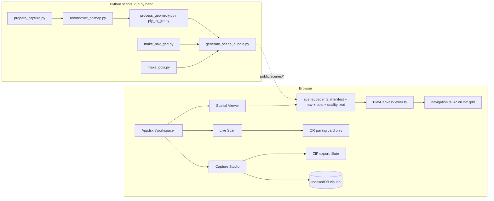

# PROJECT_STATE: Namma Space repository audit and handoff

Audit date: 2026-10-29. Repository: https://github.com/ujeshauchitha-glitch/NAMMA-SPACE
Competition: Techfest 2026-27 "Namma Space" (IIT Bombay). Round 1 submission date in the brief: **31 Oct 2026**.

**How to read this.** `[F]` = fact verified in code, Git history, or a command run (evidence given). `[I]` = inference. `[R]` = recommendation. Nothing in this file is estimated unless marked `[I]`.

**What was and was not re-run.** This audit ran fresh checks only where nothing earlier existed: the validation of `origin/main` (new code since 27 Oct), the Git forensics, and the first run on real photos. Results verified earlier in the project are cited with their dates and were deliberately **not** repeated. Not run anywhere: Playwright end-to-end tests (they need a browser download), any real-device or real-browser test of the studio app's pointer-lock and WebRTC flows.

---

## 1. Executive summary

- The repository holds **three loosely related things**: (a) a React/TypeScript/PlayCanvas **studio app** by Ashwin (capture workspace, first-person scene viewer with POI search and A* routing, phone-pairing primitives); (b) a Python **reconstruction pipeline** (video or photos to COLMAP to Gaussian-splat training to compressed web splat, with checks and a human-approval gate) and a small **Spark splat viewer**, by Ujesha and Ojas; (c) Nilesh's **scripts** that chain Ashwin's stage scripts into a GLB-based bundle flow.
- **No real reconstructed room exists anywhere in the repository.** Every scene that ships is synthetic. The pipeline has been run end to end only on a synthetic rendered clip (28 Oct). The first real input, 73 WhatsApp photos (29 Oct), was **rejected by the pipeline's own gate**: COLMAP registered 2 of 73 photos (see section 11).
- **Navigation, POIs and pathfinding exist only in the studio app and only on synthetic scenes.** The Spark viewer (hosted on Vercel) has first-person walking and a bounding box, nothing else.
- The labels T21 to T27 are **planned tasks in `docs/V1_SPEC.md`, not Git commits or stages.** Task commits stop at T20. See section 4.
- Round 1 deliverables (abstract PDF, public viewer link with a real reconstruction, 3-5 minute video, repo with sample data) are **not complete**. See section 10.

## 2. Repository identity and Git state

All facts from `git` and the GitHub API, 29 Oct 2026.

| Branch (remote) | Tip | Authors (commit count on that line) | Relation |
|---|---|---|---|
| `main` | `744f7c3` | ashvyagni 23, Nileshsrv 1, Nilesh Kumar Srivastava 1 (the merge) | Ashwin's app plus Nilesh's PR #1. History shares **no common ancestor** with `round1/viewer-pipeline`. |
| `nks` | `0d8c477` | ashvyagni 23, Nileshsrv 1 | Nilesh's branch; already merged into `main`. |
| `ashwinwork` | `86b7a66` | ashvyagni 23 | Ashwin's last commit; equals `main` minus Nilesh. |
| `round1/viewer-pipeline` | `d9f521e` | Ujesha 3 | Original Round 1 line. **GitHub's default branch.** Unrelated history to `main`. |
| `integration/round1` | `2ba0453` | ashvyagni 23, Ojas Kulkarni 17, Ujesha 3, Nilesh 2 | Contains all of `main` and all of `round1/viewer-pipeline` (merge-bases `744f7c3` and `d9f521e`). The team's current working line. |
| `ujesha/round1-fixes` | tip of this branch | Ujesha | Based exactly on `integration/round1`: setup-script fix, SfM fragment fix, pytest suite, this audit. |
| `ujesha/local-viewer-pipeline` | `89aa219` | Ujesha | Unpushed-until-28-Oct work on the old line: Pages workflow, submission docs, abstract draft, pytest, debug overlay. Overlaps and will conflict with `integration/round1`. |
| `ujesha/studio-splat-spike` | `d23a12f` | Ujesha | Splat loading in the PlayCanvas viewer and the canvas-growth fix, built on Ashwin's `main` (superseded layout; keep for cherry-picking). |

- Pull requests: #1 (`nks` to `main`, merged 27 Oct 06:41 IST, commit `744f7c3`); #2 (`integration/round1` to `round1/viewer-pipeline`, opened by GitHub user `0-Playor-0`; open at the last listing on 28 Oct). `[I]` `0-Playor-0` is the same person as Ojas Kulkarni.
- Tags: none. `[F]`
- Nilesh appears under two Git identities (`Nileshsrv`, `Nilesh Kumar Srivastava`). `[I]` same person.
- Local audit checkout was `integration/r1` at `d23a12f`, clean; no uncommitted work existed at audit start.

## 3. Development timeline (verified from `git log --all`)

| Date (IST) | Event | Evidence |
|---|---|---|
| 24 Oct | Ashwin: baseline snapshot, deps (T2), imghdr fix (T3), design tokens, icons, UI primitives (T4-T6), coverage indicator (T7), shell (T8), workspace state machine (T9) | `5c3a6d8` ... `b2565c6` |
| 25 Oct | T10 IndexedDB storage, T11 ingest pipeline, T12 Capture Studio, T13 ZIP export, T14 viewer workspace, T15 motion API | `6249316` ... `ba9e297` |
| 26 Oct | T16 POI search/route rail, T17 HUD, T18 pairing protocol, T19 LAN HTTPS + signalling relay, T20 QR pairing card, README overhaul, unlabelled "camera frame transfer primitives" | `fd86f93` ... `86b7a66` |
| 26 Oct | Ujesha (separate repo line): scaffold, validated pipeline, SOP, tests, stack record, splat compression test | `9951d1d`, `a2fc4f0`, `d9f521e` |
| 27 Oct 06:10-06:41 | Nilesh: pipeline wrapper scripts, setup guide, context file; PR #1 merged to `main` | `0d8c477`, `744f7c3` |
| 28 Oct | Ojas: integration branch (17 commits): compress stage, viewer download progress, Vercel config, Hugging Face-hosted splat, handoff doc | `integration/round1` |
| 28 Oct | Ujesha: fixes and tests on top of Ojas's branch | `13336e6`, `8fcd7ef` |

## 4. What "T21" and "T27" are `[F]`

`docs/V1_SPEC.md` (Ashwin) defines tasks T1-T27. Titles of the tail:

| Task | Title (from the spec) | Evidence it exists |
|---|---|---|
| T21 | Camera capture + datachannel handoff | **Partial.** Commit `86b7a66` (unlabelled) adds camera preview, JPEG chunking, binary messages, verified frame acks, but nothing imports the UI part (section 7). |
| T22 | three.js coverage visualizer | No commit. `three` is a dependency but no file in `src/` imports it. |
| T23 | GSAP choreography + reduced motion | No commit. |
| T24 | E2E suites | Some Playwright specs exist (`tests/e2e/*.spec.ts`) from earlier tasks; not a T24 commit. Not run in this audit. |
| T25 | Scene scripts, quality gate, build budgets | `scripts/quality_gate.py`, `benchmark_build.py` exist (earlier commits); no T25 commit. |
| T26-T27 | Docs correction; final release gate | No commit. |

**Nilesh's commits carry no T-label** and implement a different set of things (section 5.3). The statement "progressing toward T27" is **not supported by the repository**. `[F]` No commit message anywhere mentions T21 to T27.

### T20 to current `main`, net change (`git diff --shortstat 9695e10 origin/main`)
18 files, +3020/-448. Ashwin's `86b7a66` and README (camera/pairing primitives); Nilesh's `0d8c477`: `scripts/run_pipeline.py`, `ply_to_glb.py`, `make_nav_grid.py`, `make_pois.py`, `WINDOWS_SETUP.md`, `CONTEXT.md`, `vitest` ^3.2.4 to ^5.0.5. Nothing was removed or reverted; `reconstruct_colmap.py` and `prepare_capture.py` were untouched.

## 5. Architecture as implemented

### 5.1 Studio app (`main`; on `integration/round1` it lives in `apps/studio/`)
Stack `[F]` (package.json, build output): React 19, TypeScript, Vite 7, **PlayCanvas 2.23.3** (not Three.js; `three` 0.186.1 is installed but never imported), zod, idb, fflate, GSAP, `ws` dev relay; tests Vitest and Playwright.

Data contract (`src/types/scene.ts`, zod): `manifest.json` (asset refs of kind `glb|gltf|sog|procedural`, `worldFromReconstruction`, bounds, start pose, provenance), `navigation` (x-z occupancy grid: `blocked[]`, `unknown[]`, `cellSize`, `clearanceMetres`), `pois.json`, quality report. Synthetic scenes must disclose "synthetic" in provenance (schema refinement).

### 5.2 Reconstruction pipeline and Spark viewer (`pipeline/`, `viewer/` on `integration/round1`)
`pipeline/run_pipeline.py`: validate input, frames (ffmpeg, blur drop) or photo folder, COLMAP (sequential matcher for video, exhaustive for photos), SfM checks, Brush or Nerfstudio training, splat checks, `compress.py` (splat-transform to `.sog`/`.spz` under a 50 MB budget), publish; `report.json` status `failed`, `automated_checks_passed_awaiting_inspection`, `inspected_ok` (only via `--approve` with a note). Viewer: React + react-three-fiber + Spark, pointer-lock WASD, optional bounds rectangle, SYNTHETIC badge, `?debug` overlay (on `ujesha/local-viewer-pipeline` only). Hosted at `https://namma-space-pearl.vercel.app` (loads a synthetic PLY from a Hugging Face dataset; verified 28 Oct).

### 5.3 Nilesh's scripts (`scripts/` on `main`)
`run_pipeline.py` chains prepare, COLMAP, geometry (Open3D, else `ply_to_glb.py`), nav scaffold, bundle, with `--dry-run`. `ply_to_glb.py` writes a glTF with no faces as mode-0 POINTS, i.e. a point cloud, not a mesh. `make_nav_grid.py` writes an **all-walkable scaffold** that "MUST be edited"; `make_pois.py` is an authoring tool. His own `CONTEXT.md` lists COLMAP install, a real capture and a real pipeline run as NOT DONE.

### 5.4 Intentional versus accidental `[I]`
Intentional: separating visual asset from navigation data; honest "blocked/partial" reporting in the scripts. Accidental: three overlapping pipelines (Ashwin's scripts, Nilesh's wrapper, Ujesha/Ojas's `pipeline/`), two capture SOPs, two viewers, two splat/mesh asset philosophies (GLB point cloud/mesh versus Gaussian splat).

## 6. Repository map (team line `integration/round1`)

| Path | Responsibility |
|---|---|
| `apps/studio/` | Ashwin's app (identical to `main`'s root) with its docs (`ARCHITECTURE.md`, `PIPELINE.md`, `VALIDATION.md`, `CAPTURE_SOP.md`, `CONTEXT.md`, `docs/V1_SPEC.md`, ...) |
| `apps/studio/src/engine/PlayCanvasViewer.ts` | Camera, controls, collision-by-grid, POI markers, route drawing, asset loading |
| `apps/studio/src/lib/navigation.ts` | Grid helpers, A*, POI search |
| `apps/studio/src/lib/pairing/`, `lib/scan/` | WebRTC pairing and frame transfer primitives |
| `apps/studio/scripts/` | Ashwin's and Nilesh's Python scripts |
| `pipeline/` | Our pipeline (`run_pipeline.py`, `preflight.py`, `checks.py`, `compress.py`, `common.py`) |
| `viewer/` | Spark splat viewer, deployed to Vercel (`vercel.json`) |
| `scripts/setup_tools.ps1` | Downloads COLMAP, Brush, splat-transform; creates `.venv` |
| `tests/` | pytest suite for `pipeline/` (30 tests) and fixtures |
| `docs/` | Capture SOP, training guide, stack record, status, demo script, `HANDOFF_UJESHA.md`, `README.md` (index) |

`main` has the studio app at the repository root, with no `pipeline/`, `viewer/`, or deploy config.

## 7. Feature matrix

Status words as defined in the audit brief. Evidence: file paths; "V" = verified by running something.

| Capability | Status | Evidence |
|---|---|---|
| Studio app launches and builds | Implemented and verified | `npm ci`, `typecheck`, `build` pass on `main` (29 Oct) |
| Scene rendering (studio) | **Mocked/synthetic** | Both shipped scenes are synthetic: procedural boxes and a generated GLB (`scripts/generate_glb_fixture.py`) |
| Indoor geometry from real input | **Missing** (end to end) | No reconstructed scene exists; see section 11 |
| Scene import formats (studio) | **Partial** | `loadVisualAssets` loads only `glb`/`gltf`; `sog` is in the schema but ignored on `main`. Splat loading exists only on `ujesha/studio-splat-spike` (V, synthetic splat, 27 Oct) |
| Scene import (Spark viewer) | Implemented, partially verified | `.ply`/`.sog`/`.spz` render (V on synthetic data; 7k and 30k-step splats, 28 Oct) |
| Scene bundle schema + validator | Implemented and verified | zod schema; `validate_all_scenes.py` passes 2 bundles (29 Oct). The validator checks structure and hashes, not geometry or that navigation matches the visual asset |
| Camera controls | Implemented | Pointer-lock WASD, pitch clamp +/-82; movement V on the splat spike |
| Collision | **Partial** | Grid-cell test only; point player, no wall sliding, `collisionAsset` unused; unconstrained when no navigation grid (main). `ujesha/studio-splat-spike` adds a bounds-box clamp |
| Walkable-area computation | **Partial/missing** | App only consumes a hand-authored grid; the scaffold generator is all-walkable |
| POI search/selection | Implemented | Substring ranking (`navigation.ts`), UI in `components/viewer/`; synthetic POIs only |
| Pathfinding | Implemented | 8-neighbour A*, no corner cutting; `tests/navigation.test.ts`; `inflateNavigationGrid` exists but the viewer does not call it |
| Capture workspace | Implemented (local staging only) | Ingest, hashing, IndexedDB, ZIP export; it makes no pose or geometry claim; nothing uploads or processes |
| Live Scan / phone pairing | **Partial, not wired** | QR card real; `LiveScanWorkspace` renders a static empty state; `CameraPreview.tsx` never imported (V by grep); `lib/scan/*` reachable only from `lib/pairing/messages.ts:16` |
| Reconstruction pipeline | **Implemented, partially verified** | Our `pipeline/`: all stages ran on a **synthetic** clip (28 Oct: COLMAP 139/139, Brush 7k and 30k steps, compress to 17 and 31 MB). On real photos: **failed gate** (29 Oct) |
| Splat training on this hardware | Verified | Brush on an RTX 5060 Laptop, 8 GB: 1.92M splats, 21.4 min (synthetic data). Peak VRAM not measured |
| Quality reporting | Mixed | Our `report.json`: measured (registration, points, reprojection, splat checks). Studio scenes' reports: hand-written JSON with fixed scores. `generate_scene_bundle.py:127-136` marks checks "passed" and readiness "validated" whenever a navigation file is supplied, without measuring |
| Backend/API | Missing | `src/lib/api.ts` is a stub that always reports BLOCKED and is never imported |
| Deployment | Partial | Spark viewer deployed on Vercel (synthetic scene, V 28 Oct). `main` has no deploy config; studio app is not deployed |
| AR navigation | Missing | No implementation |
| Tests | See section 8 | |

## 8. Validation results

Fresh (29 Oct, Windows 11, Node 24, `origin/main` `744f7c3`, each command run once):

| Command | Result |
|---|---|
| `npm ci` | pass, 212 packages, 0 vulnerabilities (warnings: `eslint` deprecated; `esbuild` postinstall not covered by `allowScripts`) |
| `npm run typecheck` | pass |
| `npm run lint` | pass, 0 errors, 5 `react-refresh/only-export-components` warnings |
| `npm test` (vitest 5.0.5) | **393 pass, 2 fail**, 20 of 21 files pass. Failures are both in `tests/pipeline.test.ts` and Windows-only: one splits paths on `/`, the other builds a POSIX fake-COLMAP script and runs `python3` |
| `npm run build` | pass; largest chunk `PlayCanvasViewer` 2,032 kB (525 kB gzip) triggers Vite's size warning |
| `validate_all_scenes.py public/scenes` | pass, 2 bundles |
| `reconstruct_colmap.py preflight` | runs; COLMAP missing on that checkout's PATH |
| `run_pipeline.py --dry-run` (Nilesh) | prints stage commands then stops: "No PLY output found" |

Earlier, dated, not repeated: our `pipeline/` pytest suite, 30 tests pass (28 Oct); doctor, compress, Brush and COLMAP runs on synthetic data (28 Oct); splat loading and walking in the PlayCanvas viewer, synthetic (27 Oct); hosted viewer loads (28 Oct). Never run by anyone: Playwright e2e, real-browser pointer-lock tests, any WebRTC transfer between two devices, anything on a real phone capture that succeeded.

**Note:** npm scripts `validate:scenes`, `preflight:reconstruction`, `pipeline` call `python3`, which on Windows is a Microsoft Store stub. They fail on this machine unless `py -3.12` is used instead.

## 9. End-to-end workflow a person can do today

1. **Studio app (`main`):** open it, import photos in Capture Studio (staged locally), export a ZIP; switch to Spatial Viewer and walk a **synthetic** hall, search a POI, get an A* route drawn. No reconstruction is involved.
2. **Spark viewer (hosted):** open the Vercel URL and walk a **synthetic** room.
3. **Reconstruction (our `pipeline/`):** run setup, then `run_pipeline.py <video-or-photo-folder> --out work/<name>`; on a good input this yields a `.sog` splat plus `report.json` and publishes it to a local viewer. **This has succeeded only for a synthetic clip.**
4. There is **no** working path from a real capture to a scene with POIs and routes: navigation grids are hand-authored, and the studio viewer cannot display a splat on `main`.

## 10. Requirements coverage (from the competition brief supplied by the user)

| Requirement (Round 1, due 31 Oct) | State | Gap |
|---|---|---|
| Capture SOP | Implemented (two documents: `docs/SOP.md`, `apps/studio/CAPTURE_SOP.md`) | Not field-tested on a successful capture; two SOPs disagree in detail |
| 3D model of a real space, no manual modelling | **Not met** | No successful real reconstruction |
| Web viewer with free first-person roaming at a public link | Partial | Hosted viewer shows a synthetic room only |
| Technical abstract PDF (max 5 pages) | Partial | Draft exists on `ujesha/local-viewer-pipeline` (`docs/round1/ABSTRACT.md`), full of TBD, not on the team branch, no PDF |
| Demo video 3-5 min | Not started | Needs a real capture first |
| Repo with setup and sample data in a test dir | Partial | Setup scripts and tests exist; sample data is a placeholder README |
| Round 2 (POIs, search, obstacle-aware paths) | Partial, synthetic only | Exists in the studio app on fixture scenes; nothing on a real scene |
| Round 3 / AR bonus | Missing | |

The handoff (`docs/HANDOFF_UJESHA.md`) sets the real-capture outputs deadline as the evening of 30 Oct.

## 11. Known bugs and limitations (evidence, reproducibility)

1. **Real-photo run failed (29 Oct).** Input: 73 WhatsApp photos of a corrugated-metal workshop (740x1600 and 738x1600 portrait, EXIF stripped). `run_pipeline.py work/room_photos --out work/room_photos_run`: `[FAIL] sfm_registration: 2/73 frames registered (3%)`, `224 sparse points`; pipeline stopped before training, as designed. Database analysis: only **43 of 73** images were read; 232 of 903 pairs had at least 15 verified matches (best 628), but 671 pairs were flagged degenerate and none calibrated. A permissive mapper rerun gave two disconnected models of 34 and 27 images with 1,219 and 1,563 points. `[I]` cause: little or no camera translation (turning on the spot), a mostly flat repetitive wall, low resolution, compression. **This set is not usable for the submission.** `[R]` re-shoot per `docs/SOP.md` with real parallax, original-quality files (not WhatsApp).
2. **Mixed image sizes silently drop images.** Our pipeline passes `--ImageReader.single_camera 1`; the 30 photos at 738 px width were skipped (database held 43 of 73). `--check` only warns. Reproducible with that photo set. Not fixed.
3. **Canvas runaway when `devicePixelRatio != 1`.** `PlayCanvasViewer.resize()` multiplied the container size by the ratio before `resizeCanvas`; at 175% scaling the canvas grew to 981x57,687 px and went black (V, 27 Oct). Present in `main` and `apps/studio`. Fix on `ujesha/studio-splat-spike` (`d23a12f`), not on the team branch.
4. **`scripts/reconstruct_colmap.py` uses COLMAP flags COLMAP 4.2.1 rejects** (`--SiftExtraction.use_gpu`: "unrecognised option", V 26 Oct). Never exercised because the tool was never installed where it was written.
5. **Studio viewer ignores splats on `main`** (loader filters `glb|gltf`); manifest `sha256` is never verified at load.
6. **Quality labels can overstate** (section 7, `generate_scene_bundle.py:127-136`); an all-walkable scaffold plus a supplied navigation file yields "validated".
7. **Windows incompatibilities in the studio repo's scripts and tests** (section 8): `python3` assumptions, two failing tests.
8. **Dead or unused code:** `src/lib/api.ts`, `CameraPreview.tsx`, unused `three` dependency, `inflateNavigationGrid` unused by the viewer.
9. **Documentation drift:** `CONTEXT.md` mentions a FastAPI backend that does not exist and describes A* as part of the engine file (it is in `lib/navigation.ts`); `ARCHITECTURE.md` bundle examples differ from the zod schema.
10. **Browser pane measurements are unreliable** for frame rate (integrated GPU, throttled); real performance on target hardware is unmeasured.

## 12. Technical risks and dependencies

- Reconstruction needs an NVIDIA GPU and ~550 MB of downloads (COLMAP CUDA build, Brush); setup scripts are Windows PowerShell 5.1 (a Linux script exists, untested).
- Gaussian splats carry no collision geometry; a separate walkable representation is required for navigation (the studio app expects a hand-authored grid).
- Three overlapping pipelines and two viewers risk wasted effort and confusing reviewers.
- Splat size: a real 30k-step splat will be a 31+ MB `.sog` (synthetic reference); GitHub's per-file limit is 100 MB; the hosted splat currently lives in a personal Hugging Face dataset.
- Time: the Round 1 date is 31 Oct; the capture is the critical path.

## 13. Open questions (cannot be settled from the repository)

1. Which branch is the submission branch: `main`, `integration/round1`, or `round1/viewer-pipeline`? PR #2's state and any newer pushes were not re-checked after 28 Oct.
2. Which viewer is the submission viewer: Spark (can show splats today, no POIs/routes) or the PlayCanvas studio (POIs/routes, cannot show splats on `main`)?
3. Who owns the real capture, and where are the original-quality files?
4. Are the Round 2 and later deadlines and rules in the brief current (user-supplied text, not verifiable from the repo)?
5. Who are the GitHub users behind `0-Playor-0` and the two Nilesh identities (inferred only)?

## 14. Recommended next decisions `[R]` (for the project owner, no implementation authorized by this document)

1. Obtain a **real capture that follows the SOP** (walking video with parallax, original quality, one camera setting). Nothing else in Round 1 can be demonstrated without it.
2. Decide the **single submission branch and viewer** and archive the others; schedule the merge of `ujesha/round1-fixes` into `integration/round1`.
3. Decide the **navigation source for a real scene** (hand-annotated grid versus fitting a floor to COLMAP points) before Round 2 work starts.
4. Port the **canvas fix** (item 3) to `apps/studio` if the studio app stays in the submission.
