# Namma Space

**A phone video of an indoor space becomes a walkable 3D twin in the browser, with tagged places, search and
turn-by-turn walking directions.** Techfest 2026-27, IIT Bombay, Round 2. Team TM-12354C3F6F2, Vellore Institute of Technology.

**Live site: <https://namma-space-pearl.vercel.app>** (no install). It currently serves the Round 1 build; the
Round 2 features below go live when this branch (`round2/poi-nav`) is merged and deployed.

## Try it in 30 seconds

1. Open the site. In the **Scene** dropdown pick **Apartment** (it has seven tagged places; the classroom has one).
2. Press **`/`**, type `bathrom` (the typo is on purpose), press **Enter**: the camera turns to the bathroom if it is in
   view, its card opens and a faint route is drawn on the floor.
3. Click **Route here** (or press Enter again): the guidance panel shows the next step, metres left and walking time
   (from the kitchen: "Arrive in 4.4 m · 4.4 m to Bathroom · about 5 s walk").
4. Click **Follow route**: the camera walks the route at walking pace. Any movement key hands control back.
5. Or click any **label** in the 3D view (Kitchen island, Front door, ...) to open its card. Try `nearest door` in search.

Drag to look around, `W` `A` `S` `D` to walk, `F` for full screen. On a phone: one finger drags, tap a label, then
Route here and Follow route. **Immersive mode** locks the mouse for looking; `Esc` leaves it.

## Features by Round 2 criterion

| Criterion | What we built | Where |
|---|---|---|
| **Spatial Indexing & POI Tagging** | POIs with an approach point snapped to walkable floor and optional floor-zone polygons; a uniform-grid spatial index (hit tests, within-radius, nearest-k); in-world pins and labels with collision-free label layout and distance fading; an in-app POI editor (place, move, draw zones, import/export `pois.json`); schema validation of every bundle | [docs/POIS_AND_SPATIAL_INDEX.md](docs/POIS_AND_SPATIAL_INDEX.md) · `apps/studio/src/lib/poiIndex.ts`, `poiOverlay.ts`, `poiEditor.ts` |
| **Pathfinding Accuracy** | A* on the scene's occupancy grid (8-connected, no corner cutting, blocked *and* unknown cells avoided, clearance baked into the grid), binary-heap open set (39x faster than the sort-per-pop version on the classroom), start/goal snapping (≤1.5 m), string-pulled smoothing that never leaves walkable cells (300 random property-test grids), live progress, re-route when > 1 m off the path, arrival within 0.75 m | [docs/PATHFINDING.md](docs/PATHFINDING.md) · `src/lib/navigation.ts`, `routeGeometry.ts`, `routeGuidance.ts` |
| **Search UI & Transition** | Typo-tolerant ranked search (prefix > substring > fuzzy edit distance) over label, aliases, category and description; category chips; walking distance (route length, not straight line) on every result; `nearest <category>` answered through the spatial index; full keyboard use (`/`, arrows, Enter, Esc); camera turns to face a picked place; Go to view flies **along the route** (≤3 s, eased) or fades when no route exists; floor ribbon with moving chevrons and a destination beacon | [docs/SEARCH.md](docs/SEARCH.md) · `src/lib/poiSearch.ts`, `routeFlight.ts`, `components/viewer/PoiSearch.tsx` |
| **Code Cleanliness & Repository Setup** | One app (`apps/studio`), one pipeline (`pipeline/`); typed scene contract (zod); 800+ unit tests, Playwright e2e, 120+ pipeline tests; CI on every push; pinned, credited third-party tools | this README · [CREDITS.md](CREDITS.md) · `.github/workflows/ci.yml` |

## Architecture

```mermaid
flowchart LR
  subgraph Capture
    V[Phone video<br/>1080p, 1-2 min] --> F[frames + blur filter]
  end
  subgraph Pipeline["pipeline/ (Python, GPU: Kaggle T4 or Windows NVIDIA)"]
    F --> S[Camera poses<br/>COLMAP / pycolmap<br/>sequential + loop closure]
    S --> T[Gaussian splat training<br/>gsplat MCMC or Brush]
    T --> C[clean_splat<br/>needles, floaters, room box]
    C --> W[splat-transform<br/>SOG / compressed PLY]
    S --> N[scene_bundle<br/>scale, nav grid, start POI]
  end
  W --> B
  N --> B[(Scene bundle<br/>manifest.json · visual/ · navigation/grid.json<br/>semantic/pois.json · quality/report.json)]
  subgraph Studio["apps/studio (React + PlayCanvas, browser)"]
    B --> L[sceneLoader<br/>zod validation, sha256]
    L --> R[PlayCanvas viewer<br/>splat, pins, labels, ribbon]
    L --> I[POI spatial index]
    I --> Q[search ranking<br/>poiSearch]
    I --> P[A* + string-pulling<br/>navigation]
    Q --> P
    P --> G[guidance<br/>next turn, re-route, follow]
    G --> R
  end
```



## Run the app (3 commands, Node.js ≥ 22)

```bash
cd apps/studio
npm ci
npm run dev        # http://localhost:5173
```

`npm test` runs the unit tests, `npm run build` writes `apps/studio/dist`, `npm run test:e2e` runs Playwright.

## Reconstruct your own space

Film one continuous landscape video per room, 1–2 minutes at walking pace, exposure and focus locked
([capture SOP](docs/SOP.md)). Then either:

**A. Kaggle (free GPU, nothing to install).** Upload [`notebooks/kaggle_reconstruct.ipynb`](notebooks/kaggle_reconstruct.ipynb)
to Kaggle, choose **GPU T4 x2** and **Internet on**, add your video as input and **Run All**. Its first cell lists
the five clicks and the pinned versions. It writes `scene_bundle.zip` with the stage timings in `report.json`.
*This path is tested on the CPU only so far; the GPU stages have not yet run on Kaggle.*

**B. Windows PC with an NVIDIA GPU** (the path the live classroom came from):

```powershell
powershell -ExecutionPolicy Bypass -File scripts\setup_tools.ps1
.venv\Scripts\python pipeline\run_pipeline.py --doctor
.venv\Scripts\python pipeline\run_pipeline.py C:\captures\room.mp4 --out work\room --profile final --mask-people
```

Linux works the same way after `scripts/setup_tools.sh` (pycolmap + gsplat). `--profile preview` gives a quick
720p result. Copy `work/<name>/bundle/` to `apps/studio/public/scenes/<name>/` and open
`/?scene=/scenes/<name>/manifest.json`. Details: [docs/TRAINING.md](docs/TRAINING.md), [pipeline/](pipeline/).

## Tag places (POI editor)

Open the app with `?edit=1` (or click **Edit POIs** there). **Add POI** and click the floor to place a pin: its
approach point snaps to the nearest walkable cell. **Select / move** drags pins; **Draw zone** clicks floor corners,
then **Finish zone**. Edit label, aliases, category and description in the panel. The draft is kept in this
browser; **Export pois.json** downloads it, to commit as `apps/studio/public/scenes/<scene>/semantic/pois.json`.

## Scene bundle format

```text
apps/studio/public/scenes/<id>/
  manifest.json          sceneId, displayName, bounds (m), startPosition, scaleStatus, visualAssets[] (+ sha256)
  visual/                *.sog | *.ply | *.compressed.ply (Gaussian splat) or *.glb
  navigation/grid.json   occupancy grid: origin, cellSize, width, height, blocked[], unknown[], start, clearanceMetres
  semantic/pois.json     [{ id, label, category, position, approachPoint, aliases, description, zone? }]
  quality/report.json    status, readiness, warnings, checks
```

The contract is `apps/studio/src/types/scene.ts` (zod); `apps/studio/scripts/validate_scene.py` checks a bundle offline.

## Tests

| Suite | Command | Count |
|---|---|---|
| Studio unit (Vitest) | `cd apps/studio && npm test` | 804 |
| Studio end to end (Playwright) | `cd apps/studio && npm run test:e2e` | 37 (4 need a camera/WebRTC and fail headless) |
| Pipeline (pytest, CPU) | `python -m pytest tests` | 127 |

## Repository map

| Path | Contents |
|---|---|
| `apps/studio/` | The web app: viewer, POIs, search, routing, guidance, Capture Studio, Live Scan pairing |
| `apps/studio/src/lib/` | Pure logic: `navigation`, `poiIndex`, `poiSearch`, `routeGeometry`, `routeGuidance`, `routeFlight`, `sceneLoader` |
| `apps/studio/src/engine/` | PlayCanvas viewer (`PlayCanvasViewer.ts`), splat crop, tweens |
| `apps/studio/public/scenes/` | Scene bundles shipped with the site |
| `pipeline/` | Reconstruction: frames, poses, training, cleaning, compression, scene bundle |
| `notebooks/` | Kaggle notebook (and its generator) |
| `tests/` | Pipeline tests and the sample capture (`tests/sample_data/`) |
| `scripts/` | Tool setup for Windows (`setup_tools.ps1`) and Linux (`setup_tools.sh`) |
| `docs/` | Design notes, capture SOP, training guide, open issues; `docs/submission/` holds the submissions |

## Limitations

- **Zones and labels are not occluded.** Floor zones and place labels draw over furniture in front of them.
- **Scale is estimated** from an assumed 1.45 m camera height (about ±15 %) unless a scene states it is known.
- **Splat artefacts.** Views far from where the phone went streak or blur; the floor ribbon can float slightly
  above a lumpy splat floor. The bounds crop hides the haze outside the room, but not large splats inside it.
- **One floor.** No stairs, lifts or multi-storey routing.
- **The Kaggle notebook has not run on a GPU yet** (see above). Reconstruction needs an NVIDIA GPU.
- **Phones:** touch look and tap work; there is no virtual joystick, so walking means Follow route.

Open problems and next steps: [docs/OPEN_ISSUES.md](docs/OPEN_ISSUES.md). Third-party tools and licences: [CREDITS.md](CREDITS.md).
