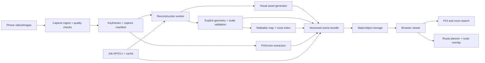

# Namma Space — Proposed Architecture

## 1. Architectural thesis

Namma Space should treat a venue as a versioned **scene bundle** with multiple synchronized representations:

1. A photorealistic visual representation for the browser.
2. An explicit geometry representation for collision and navigation.
3. A semantic representation for rooms and POIs.
4. Evidence and quality metadata describing how trustworthy the scene is.

The visual representation and the navigation representation should be separate outputs generated from the same reconstruction coordinate frame. This avoids forcing a Gaussian-splat renderer to provide collision geometry or forcing a collision mesh to carry photorealistic detail.

## 2. System context



## 3. Module boundaries

### A. Capture and ingest

**Responsibility:** turn raw phone media into a normalized, inspectable input set.

Inputs:

- `capture.mp4` or an image directory.
- Optional phone metadata.
- Optional measured scale anchors.

Outputs:

- Normalized frames.
- Frame timestamps and source hashes.
- Candidate keyframes.
- Capture-quality report.

The module must not know whether reconstruction is COLMAP, VGGT, or AMB3R. It emits a stable frame manifest.

### B. Reconstruction adapter

**Responsibility:** estimate camera poses, intrinsics, depth/points, confidence, and a reconstruction-space coordinate frame.

```text
ReconstructionAdapter.run(FrameSet, ReconstructionConfig)
  -> ReconstructionResult
```

The adapter boundary allows:

- `colmap-baseline`.
- `vggt-initializer`.
- `amb3r-experiment`.
- Future engines without viewer changes.

### C. Visual asset generator

**Responsibility:** create one or more browser-ready visual assets.

```text
VisualAssetGenerator.build(ReconstructionResult, VisualConfig)
  -> VisualAsset
```

Round 1 should output a GLB/glTF mesh or a pre-baked scene asset. A Gaussian-splat output may be added later as a second visual layer.

### D. Explicit geometry and scale validation

**Responsibility:** create collision-ready geometry, detect a floor plane, simplify obstacles, and validate metric scale.

```text
GeometryProcessor.build(ReconstructionResult, GeometryConfig)
  -> GeometryResult
```

This output is authoritative for collisions and navigation, not the photorealistic asset.

*As built (2026-10-29): the browser consumes no collision mesh — `collisionAsset` is null-only by contract and the occupancy grid is the collision model (§4, `d4acf04`). This module's mesh output is pipeline-side validation input, not a viewer asset.*

### E. Semantic extraction

**Responsibility:** associate rooms and POIs with stable world-space anchors.

Round 1/early Round 2 can use operator-authored JSON. Automated detection, OCR, segmentation, and image-text matching should populate the same schema later.

```text
SemanticExtractor.extract(FrameSet, ReconstructionResult, SemanticConfig)
  -> SemanticResult
```

### F. Navigation

**Responsibility:** derive a walkable representation and validate paths.

```text
NavigationBuilder.build(GeometryResult, NavigationConfig)
  -> WalkableMap
RoutePlanner.find(WalkableMap, start, goal, RouteConfig)
  -> RouteResult
```

The first implementation should use a 2D occupancy grid and A* with a configurable agent radius. The route validator must check bounds, blocked cells, and clearance rather than trusting the planner alone.

### G. Browser viewer

**Responsibility:** load a scene bundle and provide a usable walkthrough. React owns the application shell; PlayCanvas Engine 2.x owns the canvas and 3D entity lifecycle.

The viewer consumes only public scene contracts:

- `manifest.json` (the studio's bundle manifest; the Round 1 pipeline's viewer names the same idea `scene.json`).
- Visual asset URL(s) — `glb`/`gltf` today; `sog` is accepted by the schema but not yet rendered (§4).
- Navigation data (`navigationUri` → occupancy grid) — the collision authority; `collisionAsset` is null-only (§4).
- `pois.json` (`semanticUri`) and the quality report (`qualityUri`).
- Optional provenance references (`sourceFrameManifest`, `processingReportUri`).

It should not import Python packages, reconstruction internals, or model-specific formats directly.

### H. Job and deployment layer

**Responsibility:** run processing stages independently, cache successful outputs, expose state, and publish only validated bundles.

Round 1 can be a CLI and filesystem. A FastAPI service should be added only when upload, status, or remote processing is actually needed.

Every job must have:

- An immutable input hash.
- A pipeline version.
- A configuration hash.
- Stage-level status.
- Structured logs.
- Output artifact references.
- A retry-safe state transition.

## 4. Canonical data contracts

### `SceneManifest`

```json
{
  "schemaVersion": 1,
  "sceneId": "venue-2026-10-24-001",
  "displayName": "Venue Hall",
  "sceneKind": "reconstructed-capture",
  "description": "Main hall, captured handheld.",
  "coordinateSystem": "right-handed-y-up",
  "units": "metre",
  "worldFromReconstruction": [
    [1, 0, 0, 0],
    [0, 1, 0, 0],
    [0, 0, 1, 0],
    [0, 0, 0, 1]
  ],
  "bounds": {"min": [-12, 0, -8], "max": [14, 3.2, 9]},
  "startPosition": [0, 1.6, 2],
  "startYawDegrees": 180,
  "visualAssets": [
    {"kind": "glb", "uri": "visual/scene.glb", "sha256": "..."}
  ],
  "collisionAsset": null,
  "navigationUri": "navigation/nav-data.json",
  "semanticUri": "semantic/pois.json",
  "qualityUri": "quality/report.json",
  "scaleStatus": "estimated",
  "provenance": {
    "pipeline": "capture-to-scene",
    "pipelineVersion": "0.1.0",
    "capturedAt": "2026-10-24T00:00:00Z",
    "source": "reconstructed-capture",
    "notes": []
  }
}
```

(Implemented shape: `SceneManifestSchema` in `src/types/scene.ts`, enforced identically by `scripts/validate_scene.py`. The companion documents are `navigationUri` → occupancy grid, `semanticUri` → `pois.json`, `qualityUri` → quality report; the bundle loader returns `{manifest, navigation, pois, quality}`.)

**Schema contract (schemaVersion 1, tightened 2026-10-29, commit `d4acf04`)** — enforced identically by the zod schema (`src/types/scene.ts`) and the Python validator (`scripts/validate_scene.py`):

- `worldFromReconstruction` **must be the identity matrix**. Non-identity transforms are rejected with an actionable error: the navigation grid is an x–z raster, so a rotation or scale cannot be represented without re-baking the grid. All shipped scenes already use identity. Section 5's alignment work is therefore a pre-publication pipeline step, never a runtime transform.
- `collisionAsset` **must be `null`**. The viewer never loads a collision mesh; obstacles are declared in `navigation.blocked` / `navigation.unknown`. A non-null value is rejected with the same message in both validators.
- Every declared `uri` must be a **bundle-relative POSIX path**; manifests must be **same-origin**; `procedural://` is allowed only for procedural assets (32 MiB document cap; 256 MiB browser hash-buffer cap). The browser verifies each `sha256` via WebCrypto **before** the renderer loads the asset (previously unchecked) and surfaces distinct errors: network / not-found / http / too-large / invalid-json / invalid-manifest / invalid-uri / cross-origin / hash-mismatch.
- Visual asset `kind` accepts `glb | gltf | sog | procedural`, but **`sog` is declared-but-unrendered**: `PlayCanvasViewer.loadVisualAssets()` filters to `glb`/`gltf`, and no other component consumes `kind === 'sog'`, so an SOG scene currently loads no visual asset. The schema keeps the kind so a future splat renderer needs no breaking change (see §8).


### `FrameSet`

```json
{
  "captureId": "capture-...",
  "source": {"kind": "video", "uri": "input/capture.mp4", "sha256": "..."},
  "frames": [
    {"id": "f0001", "uri": "frames/f0001.jpg", "timestampMs": 0, "quality": 0.92}
  ],
  "captureHints": {
    "estimatedFps": 30,
    "scaleAnchors": [{"frameId": "f0030", "distanceMetres": 1.0}]
  }
}
```

### `POI`

```json
{
  "id": "poi-registration-desk",
  "label": "Registration desk",
  "category": "service",
  "roomId": "room-main-hall",
  "position": [2.4, 0.9, -1.2],
  "approachPoint": [1.8, 1.6, -0.4],
  "aliases": ["help desk"],
  "confidence": 0.98,
  "source": "operator"
}
```

## 5. Coordinate alignment and scale

The reconstruction engine owns an arbitrary reconstruction frame; the viewer's canonical frame is right-handed y-up over an x–z navigation raster. Since schemaVersion 1 was tightened (2026-10-29, commit `d4acf04`), `worldFromReconstruction` **must be the identity matrix** — the browser applies no reconstruction→world transform, and non-identity matrices are rejected by both the zod schema and `validate_scene.py` (§4):

```text
viewerPoint = reconstructionPoint      # identity-only: alignment is baked before publication, never applied at runtime
```

Because the transform cannot be applied at load time, alignment is a **pre-publication pipeline step**:

1. Choose a floor plane and a forward direction.
2. Bake a rigid transform into the visual asset, POIs, and navigation data so the floor is horizontal in the canonical frame.
3. Estimate scale from a measured distance, phone metadata, or a known venue dimension, and bake it in; record `scaleStatus` (`known`/`estimated`/`unknown`) in the manifest.
4. Record the anchor and residual error in the bundle's provenance/quality data.
5. Run automated checks for floor height, asset bounds, POI containment, and route-to-visual alignment **against the baked outputs** — they must already agree before the bundle is publishable.

If scale or alignment confidence is below threshold, the scene must be marked `needs-review` and must not be silently published as metrically accurate. Every shipped bundle today is synthetic and already in the canonical frame (identity `worldFromReconstruction`), which is what makes the identity-only contract hold without a baking step.

## 6. Quality gates

### Capture gates

- Minimum frame count and coverage.
- Blur and exposure thresholds.
- Frame overlap/motion continuity heuristic.
- Low-texture and reflective-surface warning.
- Optional scale anchor detected or explicitly waived.

### Reconstruction gates

- Minimum successfully registered frame ratio.
- Camera path continuity.
- Point/depth confidence summary.
- Floor-plane confidence.
- Scale residual.
- No catastrophic bounding-box outliers.

### Delivery gates

- Visual asset loads in the browser (declared `sha256` verified first; a mismatch is an error, never a silent load).
- `collisionAsset` is `null` and obstacles are declared in `navigation.blocked`/`navigation.unknown`; with no navigation grid the viewer refuses movement instead of walking freely.
- Start position is walkable (in-bounds, not blocked/unknown — schema-enforced).
- Route smoke test succeeds for at least one known POI.
- Bundle hashes match manifest.
- Previous deployment remains available until the new bundle passes.

## 7. Failure and recovery model

```text
queued → ingesting → keyframes-ready → reconstructing → assets-building
→ validating → publishable → published
                         ↘ failed/retryable
```

Rules:

- Each stage writes to a temporary versioned directory and commits only on success.
- A retry reuses successful earlier stages by content hash.
- A failed scene never overwrites the last-known-good scene.
- The UI reports the failed stage and next action rather than a generic error.
- Research adapters are optional; if one fails, the baseline adapter remains selectable.

## 8. Browser runtime design

The React viewer should be split into:

- `SceneLoader`: fetches and validates `manifest.json` (identity transform, null `collisionAsset`, bundle-relative URIs) and verifies declared `sha256` digests via WebCrypto before handing anything to the renderer.
- `AssetRenderer`: PlayCanvas procedural/GLB renderer first; future SOG/gsplat renderer behind the same contract.
- `FirstPersonController`: WASD, mouse look, pointer-lock lifecycle, touch-safe fallback.
- `CollisionSystem`: collision geometry or walkable-map movement constraints.
- `POIIndex`: local search over the manifest.
- `RouteOverlay`: displays route in canonical world coordinates.
- `SceneStatus`: loading, warning, failed, and unsupported-device states.

This separation prevents a renderer experiment from forcing a rewrite of controls, search, or route logic.

## 9. Deployment shape

### Round 1

```text
static web app + static scene bundle + local/offline processing CLI
```

### Round 2

```text
static web app + artifact storage + small job/status API + worker process
```

### Round 3

```text
capture upload → durable job record → GPU worker pool → validation
→ versioned artifact store → atomic scene publish → fallback deployment
```

Do not build the Round 3 topology before the Round 1 walkthrough is usable.

## 10. As-built studio runtime (shell, state, pairing, storage)

Sections 3–9 describe the target architecture. This section records what is actually implemented in `apps/studio/` as of 2026-10-29, verified by reading the modules named below (test evidence in `VALIDATION.md`).

### Shell (T8, T12)

`src/App.tsx` is a composition root: it resolves the active workspace from `?workspace=`, owns the real connectivity state (`navigator.onLine` → `● LOCAL` / `◇ OFFLINE`, honest and measured), and renders exactly one workspace panel through `AppShell` + `WorkspaceTabs`. Inactive workspaces unmount — there is never more than one live WebGL context (e2e asserts `[data-testid^="workspace-"]` count 1 and canvas count 0 while off the viewer). Tabs implement the full tablist pattern (roving tabindex, ←/→ wrapping, Home/End, `aria-selected`/`aria-controls`) with `1/2/3` and `Ctrl/Cmd+1..3` shortcuts. The three workspaces are `01 Capture Studio`, `02 Spatial Viewer` (default), `03 Live Scan`.

### State (T9, T14)

`src/state/` — a pure `workspaceReducer` wrapped by `WorkspaceStoreProvider` (React context). Hydration from injected persistence is an explicit `hydrated` gate: no first-run seed write can clobber the snapshot a restore is about to load, and every later state change persists a structured-clone-safe snapshot. First-run seeding, camera-pose persistence (rounding-stable pose key, so identical measurements never re-save), and the assertive toast region ride on the same store. Storage failures surface as typed toasts instead of breaking the session.

### Storage (T10, T13)

`src/lib/storage/db.ts` is the **only** module in `src/` that touches `indexedDB` (grep-enforced by its own header comment). Database `namma-space` v1 with stores `staged-images` (Blob + metadata + sha256 — image bytes live only in IndexedDB) and `kv` (rooms, view-groups, poses, scene snapshots). `idb` is dynamically imported at open time (lazy chunk), the `IDBFactory` is injectable for node tests, and every failure becomes a typed `StorageError`. ZIP export (T13) is byte-deterministic and contains exactly `manifest.json` + `images/<sha256>.jpg` — staged capture, never a reconstruction claim (see `PIPELINE.md`).

### Pairing (T18–T20)

`src/lib/pairing/` is DOM-independent by construction — sockets, peer connections, timers and WebCrypto are injected. The state machine runs `IDLE → PAIRING → LIVE → CAPTURING → STAGED → OFFLINE/ERROR` with a 10-minute session TTL (`SESSION_TTL_MS`); once expired, `OFFLINE` is the only reachable transition. Signalling is a single same-origin `ws` endpoint at `/ws?session=TOKEN` served by the dev server itself (Vite plugin `scripts/ws-signalling-plugin.ts`, pure room logic in `scripts/signalling-relay.ts`): rooms of exactly two peers, verbatim `sdp`/`ice` relay, honest `ROOM_FULL` error + close codes. `npm run dev:lan` (`VITE_LAN=1`) binds `0.0.0.0` with self-signed HTTPS because phone `getUserMedia` requires a secure context; on plain HTTP the app renders a UI-derived `BLOCKED` verdict with the exact remedy copy — presentation only, never a canonical machine state. ICE attempts **host candidates only** first (`iceServers: []`), so a same-LAN pairing needs no internet for its first attempt; a public STUN fallback engages only if that fails. The QR card encodes `window.location.hostname` plus a same-LAN caveat. Executable runbook: `docs/PAIRING.md`. Security posture: dev-only, session token in the URL query, no `Origin` validation — the relay must never be exposed in production (D-013).

Verification: `pairing-protocol`, `signalling-relay`, `qr`, `pairing-blocked` unit suites; live `dev:lan` smoke in `VALIDATION.md` (29 Oct); the e2e shell spec's offline test.
