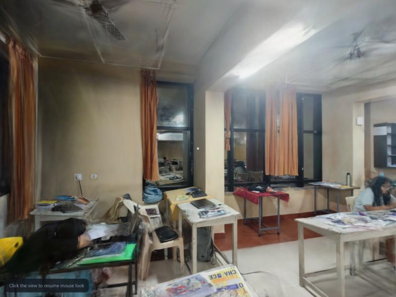
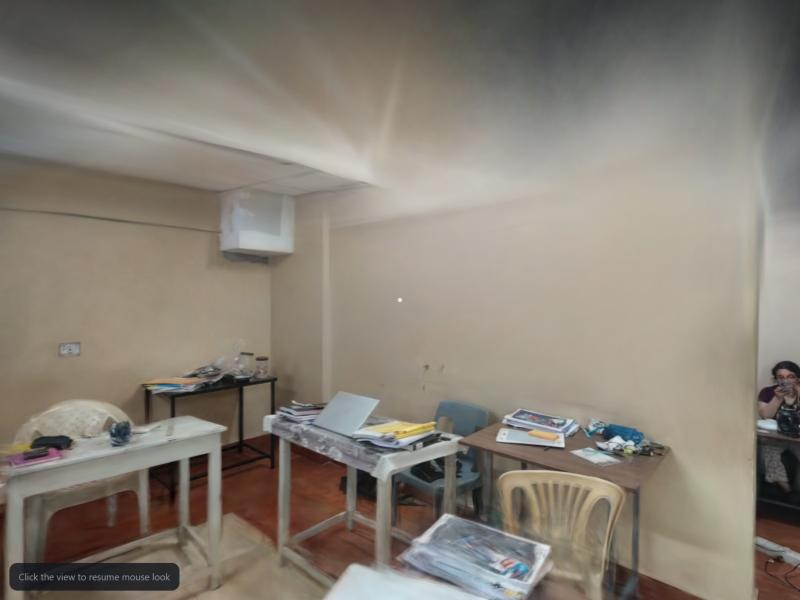

# Namma Space: Technical Abstract (Round 1)

Team: **[TBD names, institute]** · Team ID: **[TBD]** · Repo: https://github.com/ujeshauchitha-glitch/NAMMA-SPACE · Live viewer: **[TBD URL]**

## 1. Problem and approach
Turn an ordinary smartphone video of an indoor space into a photorealistic 3D model that can be walked through in a web browser, with no manual 3D modelling. Round 1 covers the capture procedure, reconstruction and free-roaming first-person exploration. Points of interest and path planning (Round 2) are designed for, not implemented.

Approach: structure-from-motion (COLMAP) recovers camera poses; 3D Gaussian Splatting (Brush) trains a photorealistic scene; the browser renders it with Spark. Splats are a rendering representation, not collision geometry, so the Round 2 navigation layer is planned separately (section 6).

## 2. Architecture
```
smartphone video -> validate -> frames + blur filter -> COLMAP (poses, sparse model)
  -> Gaussian-splat training (Brush) -> output checks -> compressed .sog -> web viewer
     (React + TypeScript + Vite + react-three-fiber + Spark)
```
Every stage is a separate command with its own output check, so a stage can be re-run or moved to another machine. A run is only reported successful after a person walks the result and approves it.

## 3. Capture SOP
Full procedure in `docs/SOP.md`. Rules and why:
- 1x lens, stabilisation off, locked focus/exposure: one fixed camera model; stabilisation warps frames and breaks pose estimation.
- Slow walking (~0.5 m/s), no fast rotation: blur is the main cause of failed reconstruction.
- Perimeter loop, centre passes, corner pans, two-way doorway crossings: every surface is seen from 3+ positions; the closed loop lets the solver cancel drift.
- Original-quality file: a WhatsApp-compressed 480p copy of a clip registered only 14% of frames; the original 1080p registered 94%.

## 4. Reconstruction pipeline
1. **Input validation** (resolution, duration, frame rate, disk space) rejects unusable captures before any compute is spent.
2. **Frames:** 3 fps, blurriest 15% dropped (Laplacian variance); 306 frames kept.
3. **COLMAP 4.2.1** (CUDA): SIFT features, exhaustive matching, incremental mapping. **287/306 frames registered (94%)**, 35,337 sparse points, mean reprojection error 0.81 px. The default sequential matcher registered only 27% of the same clip, so large rooms use exhaustive matching.
4. **Splat training:** Brush 0.3.0, 30,000 steps, RTX 5060 laptop GPU, **1,825,915 splats**, 39.8 min.
5. **Output checks:** file parses, all 3DGS attributes present, size matches header, finite values, sane extent.
6. **Web copy:** splat-transform 3.10.3 to `.sog`: **27.7 MB** from a 430.9 MB PLY (budget 50 MB), 65 s.
7. **Human inspection gate:** `inspected_ok` is set only by `--approve` after a person walks the scene. **[TBD: inspection note]**

## 5. Web viewer
React + TypeScript + Vite; Three.js via react-three-fiber; Spark renders the splats. First-person controls: pointer-lock mouse look, WASD, sprint, height adjust; touch fallback. A scene is described by `scene.json` (splat, spawn, orientation, scale, walk bounds), so a new capture needs no code change. Measured performance: **[TBD fps / device / load time]**.

## 6. Design for Round 2 (not implemented)
POIs as JSON in metre-scaled coordinates; a walkable-area grid with A* pathfinding. Splats carry no reliable surfaces, so the grid is first hand-annotated from a floor plan, with floor-plane fitting on COLMAP's sparse points as the upgrade. AR navigation is deferred.

## 7. Results
First real capture: one classroom, 180 s, 1080p, handheld phone video.

{width=48%} {width=48%}

| Metric | Value |
|---|---|
| Frames registered | 287 / 306 (94%) |
| Sparse points / reprojection error | 35,337 / 0.81 px |
| Splats | 1,825,915 |
| Web file | 27.7 MB (.sog) |
| Training / compression time | 39.8 min / 65 s |

Observed artefacts: smeared ceiling (rarely filmed), ghosting around moving people, floaters mid-room.

## 8. Limitations
- No collision in Round 1: the viewer can walk through walls except for an optional bounding rectangle.
- Scale and orientation are set by hand in `scene.json`; the first scene's scale is not yet metric.
- Mirrors, glass, plain walls and moving people degrade the result.
- Splat compression is lossy; reconstruction needs an NVIDIA GPU, the viewer needs only WebGL2.
- Training on a laptop required thermal throttling (paused 136 times); a desktop GPU avoids this.

## 9. Tools and licences
COLMAP (BSD), Brush (Apache-2.0), Spark (MIT), three.js (MIT), react-three-fiber (MIT), React (MIT), Vite (MIT), OpenCV (Apache-2.0), ffmpeg, splat-transform (MIT).
